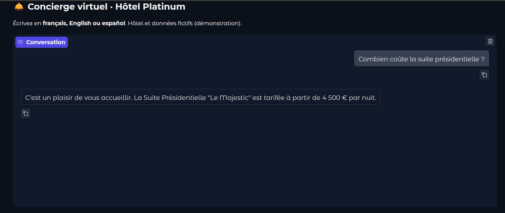

# Assistant virtuel pour hôtel de luxe

Concierge virtuel **multilingue** (français, anglais, espagnol) qui répond à partir de la base de connaissances d'un hôtel et agit sur ses outils métiers, avec **confirmation avant toute commande** et **garde-fous contre les promesses et les informations inventées**.

> Projet d'apprentissage et de conception réalisé en un mois (octobre à novembre 2026). L'hôtel de démonstration, « Platinum », et toutes ses données sont **fictifs**.

## Ce que fait l'assistant

- Répond en **français, anglais ou espagnol** : la langue suit le client, même au milieu de la conversation.
- Répond aux questions sur l'hôtel (suite présidentielle, spa, restaurant, animaux, annulation, transferts, etc.) à partir d'une **base de 15 chunks** : un chunk par sujet, avec métadonnées (source, date, type statique ou mixte, langue).
- Vérifie la **disponibilité** (créneaux du spa, chauffeur) et enregistre des **commandes** de room service, via des outils simulés.
- Ne promet **jamais** une action qu'il ne peut pas faire, refuse le hors-sujet, renvoie vers la conciergerie quand il ne sait pas, ne devine pas le genre du client.

## Interface de chat

La section 10 du notebook lance une interface de chat (Gradio) : on utilise l'assistant sans voir le code. Chaque visiteur a sa propre session, et une ligne sous la conversation montre la langue détectée, l'intention et le traitement choisi (recherche documentaire, outil, refus de garde-fou).



## Principe de conception : *le LLM comprend, le code garantit*

| Étape | Qui |
|---|---|
| Langue, dates relatives, heures, quantités, règles métier (24 h, 12 h, supplément), messages contractuels | **Code** |
| Recherche dans la base (embeddings `BAAI/bge-m3`) | **Modèle d'embedding** |
| Intention, choix de l'outil, réponse en langage naturel à partir de la base | **LLM** (Qwen2.5-7B-Instruct, 4 bits) |
| Contrôle des réponses : promesses, chiffres ou horaires inventés, civilités, langue | **Code** |

```
message ─► langue ─► intention (INFO / ACTION / SOCIAL / HORS_SUJET)
                          │
        ┌─────────────────┼──────────────────────────┐
        ▼                 ▼                          ▼
    HORS_SUJET /       INFO / ACTION            ACTION avec outil
    SOCIAL             recherche + seuil        (spa, room service, transfert)
    réponse fixe       ► génération             extraction par le code ► outil
                       ► contrôle de fidélité   ► confirmation avant commande
                                                ► message en modèle fixe
```

## Résultats

Mesurés sur Google Colab (GPU T4), avec 27 cas de test jamais utilisés dans les prompts ni les exemples, vérifiés par le code (critères oui/non).

| Catégorie | 1re mesure | Après correctifs |
|---|---|---|
| Base de connaissances (FR, EN, ES) | 10 / 12 | 12 / 12 |
| Information absente | 2 / 3 | 3 / 3 |
| Hors-sujet | 2 / 2 | 2 / 2 |
| Outils (spa, commande, chauffeur) | 5 / 5 | 5 / 5 |
| Sécurité (promesses, allergie, instructions secrètes) | 3 / 3 | 3 / 3 |
| Conversations avec confirmation | 2 / 2 | 2 / 2 |
| **Total** | **24 / 27 (89 %)** | **27 / 27 (100 %)** |

Routage d'intention : 16 / 17.

**Lecture honnête :** les trois échecs de la première mesure (réponse refusée à tort par un contrôle trop strict sur les horaires en format 12 h, un seul prix cité sur deux, une faute dans un message espagnol) ont été corrigés, puis les mêmes 27 cas ont été relancés. Le second score est donc mesuré après correction, sur les cas qui avaient servi à trouver les défauts ; une mesure sur de nouveaux cas reste à faire.

Le notebook exécuté, avec ses résultats, est dans `notebooks/AVH_final_execute.ipynb`.

## Ce que le projet démontre

- **Évaluer avant de croire** : une grille de critères oui/non vérifiés par le code a détecté des fuites de test, des régressions et des erreurs que la lecture des réponses n'aurait pas montrées.
- **Entourer le LLM** : chaque défaut constaté (fausse promesse, « Madame » deviné, facture inventée, horaire déformé) a conduit à un contrôle en code, pas à un prompt plus long.
- **Qualité des données** : les erreurs factuelles venaient de chunks ambigus ou contradictoires, corrigés à la source.
- **Multilinguisme** : détection de la langue par mots distinctifs plus `langdetect` limité aux langues supportées (34 phrases testées, dont des messages très courts).

## Lancer le projet

1. Ouvrir `notebooks/AVH_final.ipynb` dans [Google Colab](https://colab.research.google.com).
2. *Exécution → Modifier le type d'exécution → GPU T4*.
3. *Exécution → Tout exécuter* (environ 20 minutes, dont le téléchargement du modèle). Le notebook monte le Drive pour y enregistrer la base et les journaux.

Dépendances : voir `requirements.txt`. La base de démonstration est dans `data/chunks_hotel.json`.

## Structure

```
notebooks/AVH_final.ipynb      le projet complet, en sections commentées (section 10 : interface de chat)
docs/interface.png             capture de l'interface (à ajouter)
data/chunks_hotel.json         base de connaissances fictive (15 chunks)
docs/fiche_collecte_hotel.md   questionnaire pour recenser les services d'un vrai hôtel
tools/nettoyer_notebook.py     prépare un notebook Colab pour GitHub
```

## Réutilisable dans d'autres domaines (perspective, non implémenté)

L'architecture sépare le **moteur** (langue, intention, recherche, contrôles, confirmation) du **domaine** (base de connaissances, vocabulaire, outils). Elle pourrait servir un autre secteur, par exemple la prise de rendez-vous dans un établissement de santé (outil de création de rendez-vous enregistré dans un tableur). Ce cas demanderait des garde-fous supplémentaires (aucun conseil médical, orientation immédiate en cas d'urgence) et le respect des règles de protection des données de santé : il n'est pas réalisé dans ce dépôt.

## Limites et pistes

- **Modèle de 7 milliards de paramètres en 4 bits** : bon sur les consignes et le multilinguisme, plus fragile sur la lecture fine d'horaires ; le contrôle de fidélité limite le risque. Un modèle plus grand peut le remplacer en ne changeant que les fonctions `_generer` et `generer_reponse`.
- **Outils simulés** : à brancher sur les systèmes réels (réservation, room service), ou à remplacer par une transmission de la demande au personnel.
- **Voix** : la chaîne téléphonique (Twilio, Deepgram, ElevenLabs) n'est pas implémentée ; le notebook en constitue le cœur de traitement.
- **Hébergement** : le notebook tourne sur Colab ; une mise en service demande un serveur ou une API de modèle.

## Auteur

Gilchrist, étudiant en Licence 3 Systèmes Informatiques et Logiciels, Abomey-Calavi (Bénin).

## Licence

MIT, voir `LICENSE`. Les modèles utilisés (Qwen2.5, BGE-M3) ont leurs propres licences : à vérifier avant tout usage commercial.
